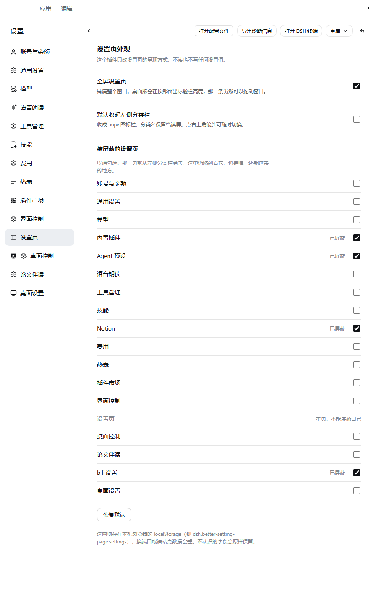

# Better Setting Page

**English** · [中文](README.zh.md)

> **Your settings page is a 800px modal. Give it the window.**
> The dialog fills the screen, and its section rail collapses to a 56px icon
> column when you want the space back — including in a portrait window, where the
> rail and the content were fighting over the same 800px.

## Why install this

Every plugin that registers a settings page adds a row to the rail, so the dialog
grows into something that wants width — a page with a card per category is
unreadable at 800px, and the screen around it is yours, not the dialog's. This
plugin adds **no settings of its own**; it gives the existing page the room it
should have had, and hands 132px back to the content on demand.

## Screenshots


*Hide the pages you never open:* built-in plugins, Agent presets, Notion and bili
are unticked here, so they are gone from the left rail — and this page is the only
way back into them.



*Portrait windows still fit:* the rail and the content column stop fighting over
the same 800px, so a tall narrow window stays readable.


*The rail collapses to icons:* 56px wide, with the section names kept for screen
readers; the arrow in the header brings it back.

## Install

```powershell
dsh plugin --profile <profile> add dsh-better-setting-page
# then restart that profile's window — the browser is still holding the old bundle
dsh --profile <profile>
```

`Requires DSH ≥ 0.2.x` — exact floor pending confirmation. Verified against
harness `0.2.2-rc.1` (`@deepseek-ai/dsh-client-ui-settings-general` 0.2.2-rc.1 in
the unpacked asar); if a later build moves those anchors, the switches would
simply stop matching, and [For plugin developers](#for-plugin-developers) says
what to look at.

### Why a restart is required

The client bundle is loaded once per window. Nothing here is hot-swapped.

## What you get

| | |
|---|---|
| Full-window page | The dialog fills the window; the panel radius and drop shadow go away. On desktop the title-bar height is kept as padding, and that strip still drags the window. |
| Collapsible rail | A chevron at the header's **left edge** collapses the section list to 56px of icons. Section names stay in the accessibility tree, so screen readers and `Tab` still announce them. |
| Remembered in this browser | All three switches live in this browser profile's `localStorage`, key `dsh.better-setting-page.settings`. |
| Its own settings page | Under **Settings → Settings page** you get three switches, a **hidden pages** list and **Restore defaults**. Without that page, a user who dislikes full screen would have to uninstall the plugin. |

Full screen is **on by default**, the rail is **expanded by default**, and the
open/close animation is **on by default**. All three are switchable, all three
take effect **on the spot** — no reload, no restart — and all three choices
survive a restart.

The header reads the way a settings page is expected to: **collapse on the left,
exit on the right**. The close button in that corner draws a **return arrow**
instead of an ✕.

### Closing still works the same

It is still the host's own button — same node, same handler, same accessible
name — so nothing about closing changed, only the glyph. `Esc`, the close button
and a click on the mask all still work. The mask is still there and still
clickable; with full screen on it is simply covered by the panel, so in practice
`Esc` and the close button are what you reach for.

## What collapsing the rail actually buys you

Saving 132px sounds like housekeeping. It is not: the rail is where a settings
page competes with itself for width, and collapsing it is the one change that
helps both ways you can hold the window.

- **Wide window, rail and content side by side.** The section list drops from
  188px to a 56px icon column and that width goes straight to the content. Long
  explanations stop breaking at awkward points, multi-column rows stop
  squeezing, and a settings line that was turning into a paragraph fits on one
  line again.
- **Tall or narrow window — portrait, half-screen, a small laptop.** Here the
  rail is not just unused space, it is a fight: the section names and the content
  both want to be legible in the same 800px, and the thing that loses is what you
  came to read. Collapsed, the names step aside, the content stops needing
  horizontal scrolling, and nothing has to wrap into a wall of text.

So the switch is not about having less chrome. It is about the same page staying
readable in both orientations — in a portrait window and in a landscape one
alike, the layout gets calmer and looks better than it does with the rail
standing open.

The rail is collapsed by CSS only; the section names are visually hidden, not
removed, so `Tab` still lands on each entry and a screen reader still announces
it. There is no hover-to-expand: the arrow toggles, nothing else moves.

## Panel open/close animation

The settings page plays a short entrance: the panel lands first, then the title,
rail, header and content rows float up over the next half second — 458ms in
total, measured rather than guessed. The window-size dialog gets a 260ms rise
instead of the stagger, because a small dialog that staggers reads as broken.

Closing is faster and simpler: 150ms full-screen, 160ms window, a fade with a
small upward drift. The host removes the page synchronously, so the animation is
played on the very node that just left the tree and then dropped — the page never
blinks back.

Turn it off with **Settings page open/close animation** on our page. It is also
skipped outright when the system asks for reduced motion — not shortened, skipped.

## Settings — what you can configure

Four fields, all on this plugin's own page:

| Field | Default | Meaning |
|---|---|---|
| `fullscreen` | `true` | Fill the window instead of 800px. |
| `navCollapsed` | `false` | Collapse the section rail to icons. |
| `motion` | `true` | Animate the page opening and closing. |
| `hidden` | `[]` | Section ids taken out of the rail. See [Hidden pages](#hidden-pages). |

Stored shape:

```json
{ "version": 1, "fullscreen": true, "navCollapsed": false, "motion": true, "hidden": [], "unknown": {} }
```

Keys this version does not recognise are carried in `unknown` and written back,
so a downgrade or a newer build does not lose data. A malformed record falls
back to defaults instead of throwing.

## Hidden pages

Every plugin that registers a `settings.section` adds a row to the rail, and a
few of those rows you may never touch. This page can take any of them out of the
way without uninstalling anything — and the same page keeps them reachable.

The list is built from the slot registry (`ctx.slots.entries("settings.section")`),
not from the DOM. At cold start the rail is not mounted, so a DOM-driven list
would come back empty and overwrite your choices with nothing.

- **All pages are listed, including the hidden ones.** A hidden page stays
  clickable here and opens normally. Hiding something you can then only reach
  through the thing that hid it is still reachable; what would be unacceptable is
  a one-way door.
- **This page cannot hide itself.** It has no checkbox, and its own id never
  survives in `hidden` even if something writes it there.
- **A hidden row comes back while you are on it.** The rule is
  `nav [data-bsp-hidden="1"]:not([aria-current="true"])`, so after you open a
  hidden page from this list the rail still shows where you are.
- **Opening is verified, not fired and forgotten.** The click goes through the
  shell's own store (`openSection`) and then polls `aria-current` for about
  320 ms; if the store call does not land, the row is clicked directly. The store
  only sets `activeId` — it does not guarantee a render.

`hidden` holds section ids: strings, trimmed, emptied of duplicates, never the
empty string, never this page's own id, capped at 64 entries.

## Limits

- **Not a full-screen window.** `html[data-fullscreen]` is the *window's* state,
  not this plugin's; forcing it would also change where the host anchors its
  menus. This page fills the window that exists.
- **Desktop only for the drag strip — and not yet verified there.** On the web
  runtime there is no title bar (`--dsh-frame-top-clearance` is unset), so the
  computed padding is `max(0px, 0px)`: the plugin adds no strip and no drag
  region, which means the one thing this release cannot demonstrate is the thing
  the strip exists for. Until a real Desktop app run says otherwise, treat the
  40px drag area as **unverified**.
- **Narrow windows keep the host layout.** Below 768px the harness turns the
  panel into a full-screen sheet on its own; collapsing to 56px there would
  leave nothing, so the collapse rule is behind `@media (min-width: 768px)`.
- **Settings are per origin.** A different port is a different profile: your two
  switches and the hidden list reset there.
- **Hiding is a rail change, not an uninstall.** A hidden page still exists, still
  registers, and still runs; only its row is gone. Nothing about that plugin is
  disabled, so do not use this to "turn off" a plugin you do not trust.

## For plugin developers

Everything hangs off two attributes this plugin owns on `<html>`:

```html
<html data-bsp-fullscreen="on" data-bsp-nav="collapsed">
```

One stylesheet reads them. No re-render on the host's React tree, and the only
`MutationObserver` watches `document.body` for the panel being portalled in — it
tags nav rows with a data attribute and never rewrites host markup. No writes to
any host store except `openSection`, which is how a page is opened anyway. The
host may mount, unmount and remount the panel at will: the switches are
already on the root element, and the row tags are re-applied on each mount.

### Three things about the shipped DOM worth knowing

**1. `[data-slot="…"]` is a renderer anchor, not a container.** The renderer's
`SlotOutlet` emits it with `style: { display: "contents" }`, so the element
generates no box: its children take part in the *grandparent's* layout. It also
sits inside `.actions` / `.options`, never directly under `.header`. So:

```css
/* correct: match the header row by descendant */
div[data-shortcut-modal="settings"] > div:has([data-slot="settings.action"])
/* wrong, silently matches .actions: */
div[data-shortcut-modal="settings"] > div:has(> [data-slot="settings.action"])
```

**2. The mask owns click-outside-to-close.** `div.mask` carries `onClick={onClose}`.
`display: none` or `pointer-events: none` on it does not "clean up the overlay",
it deletes a feature with no error. This plugin only strips the mask's *paint*
(`background: transparent; backdrop-filter: none`) and leaves its box alone.

**3. The grid area names are CSS-Modules hashes.** Override only the
`grid-template-columns` longhand. Rewriting the `grid-template` shorthand would
also reset `"title header" / "nav options"` and collapse the layout.

There is no `!important` and no host class name in the stylesheet: every rule is
anchored on `div[data-shortcut-modal="settings"]`, which is a stable data
attribute and already more specific (0,1,1) than the shipped module classes
(0,1,0).

## Files

```
client.js            browser half: stylesheet, rail toggle, settings page
index.js             host half: exists so the bundle resolves, injects nothing
cordis.patch.yml     bundle patch
locale/              zh + en strings for the section label and its page
screenshots/         the images the placeholders above are waiting for
test/settings-page.test.mjs   57 checks, no dependencies
```

## Tests

```powershell
node --check client.js
node --check index.js
node test/settings-page.test.mjs     # → PASS — 57 groups
```

The suite executes the real `client.js` with a stubbed `window.__ModuleLoader__`
and asserts on the exported strings and store. It carries four regression traps,
each verified to turn the suite red before being reverted: the header selector
being "simplified" back to a direct child, the full-screen rules no longer gated
on this plugin's own attribute, the hide rule no longer scoped to rows we marked
ourselves, and the nav sync no longer applying the stored hidden list at install
time (without it, hiding would only take effect after a manual settings change).

Whether the page really fills the window is a machine check, not a unit test: the
real `client.js` was also loaded in Chrome against a DOM copied from the host's
panel, with the panel absent at `apply()` time and portalled in afterwards — the
real cold-start order. Details and measured numbers are in [CHANGELOG.md](CHANGELOG.md).

## License

MIT
