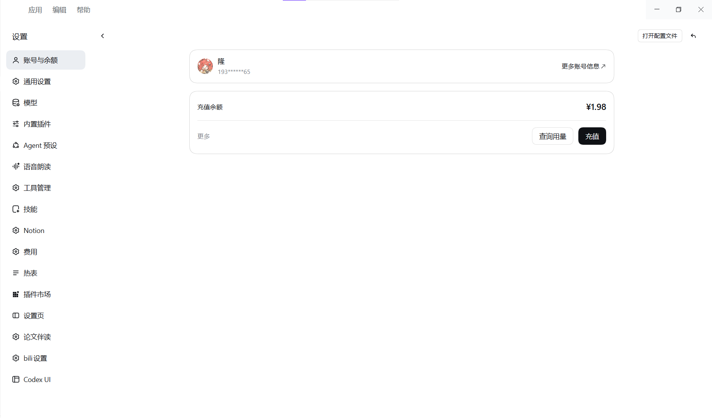
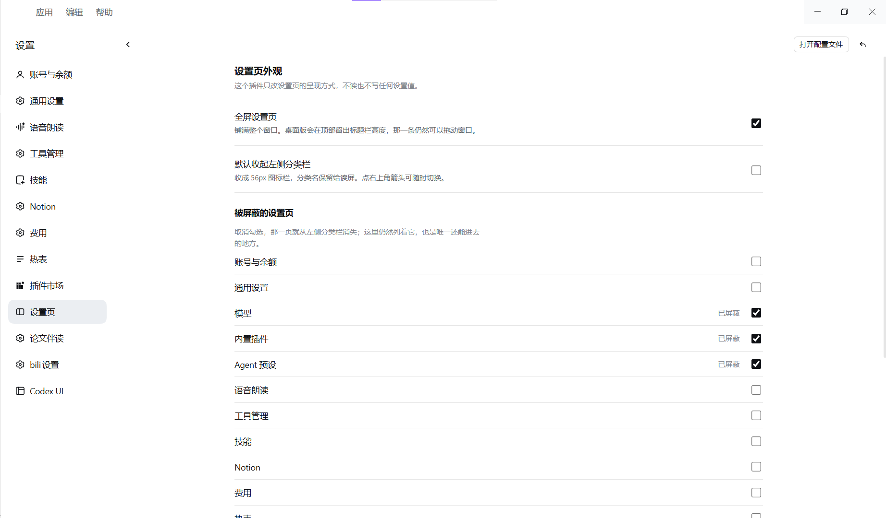

# Better Setting Page

Makes the DeepSeek Harness settings dialog a full-window page, and lets its
section rail collapse to a 56px icon column.

Settings in this harness open as an 800px-wide modal. That is fine for three
rows of switches and cramped for anything else — a category page with a card
per category is unreadable at that width, and the wasted screen is the user's.
This plugin does not add settings; it gives the page the room it should have had.

Verified against harness `0.2.2-rc.1` (`@deepseek-ai/dsh-client-ui-settings-general`
0.2.2-rc.1 in the unpacked asar) — see [How it works](#how-it-works) for the exact
anchors, so you can tell whether a later build still matches.

## Install

    dsh plugin --profile <profile> add dsh-better-setting-page

Restart that profile's window afterwards: the browser caches the old bundle.

## What you get

| | |
|---|---|
| Full-window page | The dialog fills the window; the panel radius and drop shadow go away. On desktop the title-bar height is kept as padding, and that strip still drags the window. |
| Collapsible rail | A chevron at the header's **left edge** collapses the section list to 56px of icons. Section names stay in the accessibility tree, so screen readers and `Tab` still announce them. |
| Remembered in this browser | Both switches live in this browser profile's `localStorage`, key `dsh.better-setting-page.settings`. |
| Its own settings page | Under **Settings → Settings page** you get two switches, a **hidden pages** list and **Restore defaults**. Without that page, a user who dislikes full screen would have to uninstall the plugin. |

Full screen is **on by default**; the rail is **expanded by default**. Both are
switchable, and both choices survive a restart.

The header reads the way a settings page is expected to: **collapse on the left,
exit on the right**. The close button in that corner draws a **return arrow**
instead of an ✕. It is still the host's own button — same node, same handler,
same accessible name — so nothing about closing changed, only the glyph.

Closing works exactly as it did before: `Esc`, the close button, and a click on
the mask. The mask is still there and still clickable — with full screen on it is
simply covered by the panel, so in practice `Esc` and the close button are what
you reach for.

### What collapsing the rail actually buys you

Saving 132px sounds like housekeeping. It is not: the rail is where a settings
page competes with itself for width, and collapsing it is the one change that
helps both ways you can hold the window.

- **Wide window, rail and content side by side.** The section list drops from
  188px to a 56px icon column and that width goes straight to the content. Long
  explanations stop breaking at awkward points, multi-column rows stop
  squeezing, and a settings line that was turning into a paragraph fits on one
  line again.
- **Tall or narrow window — portrait, half-screen, a small laptop.** Here the
  rail is not just unused space, it is a fight: the section names and the content
  both want to be legible in the same 800px, and the thing that loses is what you
  came to read. Collapsed, the names step aside, the content stops needing
  horizontal scrolling, and nothing has to wrap into a wall of text.

So the switch is not about having less chrome. It is about the same page staying
readable in both orientations — in a portrait window and in a landscape one
alike, the layout gets calmer and looks better than it does with the rail
standing open.

The rail is collapsed by CSS only; the section names are visually hidden, not
removed, so `Tab` still lands on each entry and a screen reader still announces
it. There is no hover-to-expand: the arrow toggles, nothing else moves.

## Screenshots



The 800px dialog is now the page: the section rail runs down the left edge with
every installed plugin's page in it, and the content column gets the rest of the
window.



This plugin's own page under **Settings → Settings page**: the two switches, and
the hidden-pages list with *Models*, *Built-in plugins* and *Agent presets*
ticked. Those three are gone from the rail on the left, and this list is the only
place that can still open them.

## How it works

Everything hangs off two attributes this plugin owns on `<html>`:

    <html data-bsp-fullscreen="on" data-bsp-nav="collapsed">

One stylesheet reads them. No re-render on the host's React tree, and the only
`MutationObserver` watches `document.body` for the panel being portalled in — it
tags nav rows with a data attribute and never rewrites host markup. No writes to
any host store except `openSection`, which is how a page is opened anyway. The
host may mount, unmount and remount the panel at will: the two switches are
already on the root element, and the row tags are re-applied on each mount.

Three things about the shipped DOM are worth knowing before you write a similar
patch.

**1. `[data-slot="…"]` is a renderer anchor, not a container.** The renderer's
`SlotOutlet` emits it with `style: { display: "contents" }`, so the element
generates no box: its children take part in the *grandparent's* layout. It also
sits inside `.actions` / `.options`, never directly under `.header`. So:

    /* correct: match the header row by descendant */
    div[data-shortcut-modal="settings"] > div:has([data-slot="settings.action"])
    /* wrong, silently matches .actions: */
    div[data-shortcut-modal="settings"] > div:has(> [data-slot="settings.action"])

**2. The mask owns click-outside-to-close.** `div.mask` carries `onClick={onClose}`.
`display: none` or `pointer-events: none` on it does not "clean up the overlay",
it deletes a feature with no error. This plugin only strips the mask's *paint*
(`background: transparent; backdrop-filter: none`) and leaves its box alone.

**3. The grid area names are CSS-Modules hashes.** Override only the
`grid-template-columns` longhand. Rewriting the `grid-template` shorthand would
also reset `"title header" / "nav options"` and collapse the layout.

There is no `!important` and no host class name in the stylesheet: every rule is
anchored on `div[data-shortcut-modal="settings"]`, which is a stable data
attribute and already more specific (0,1,1) than the shipped module classes
(0,1,0).

## Switches

| Field | Default | Meaning |
|---|---|---|
| `fullscreen` | `true` | Fill the window instead of 800px. |
| `navCollapsed` | `false` | Collapse the section rail to icons. |
| `hidden` | `[]` | Section ids taken out of the rail. See [Hidden pages](#hidden-pages). |

Stored shape:

```json
{ "version": 1, "fullscreen": true, "navCollapsed": false, "hidden": [], "unknown": {} }
```

Keys this version does not recognise are carried in `unknown` and written back,
so a downgrade or a newer build does not lose data. A malformed record falls
back to defaults instead of throwing.

## Hidden pages

Every plugin that registers a `settings.section` adds a row to the rail, and a
few of those rows you may never touch. This page can take any of them out of the
way without uninstalling anything — and the same page keeps them reachable.

The list is built from the slot registry (`ctx.slots.entries("settings.section")`),
not from the DOM. At cold start the rail is not mounted, so a DOM-driven list
would come back empty and overwrite your choices with nothing.

- **All pages are listed, including the hidden ones.** A hidden page stays
  clickable here and opens normally. That is the point: hiding something you can
  then only reach through the thing that hid it is still reachable, so hiding is
  never a one-way door.
- **This page cannot hide itself.** It has no checkbox, and its own id never
  survives in `hidden` even if something writes it there.
- **A hidden row comes back while you are on it.** The rule is
  `nav [data-bsp-hidden="1"]:not([aria-current="true"])`, so after you open a
  hidden page from this list the rail still shows where you are.
- **Opening is verified, not fired and forgotten.** The click goes through the
  shell's own store (`openSection`) and then polls `aria-current` for about
  320 ms; if the store call does not land, the row is clicked directly. The store
  only sets `activeId` — it does not guarantee a render.

`hidden` holds section ids: strings, trimmed, emptied of duplicates, never the
empty string, never this page's own id, capped at 64 entries.

## Limits

- **Not a full-screen window.** `html[data-fullscreen]` is the *window's* state,
  not this plugin's; forcing it would also change where the host anchors its
  menus. This page fills the window that exists.
- **Desktop only for the drag strip — and not yet verified there.** On the web
  runtime there is no title bar (`--dsh-frame-top-clearance` is unset), so the
  computed padding is `max(0px, 0px)`: the plugin adds no strip and no drag
  region, which means the one thing this release cannot demonstrate is the thing
  the strip exists for. Until a real Desktop app run says otherwise, treat the
  40px drag area as **unverified**.
- **Narrow windows keep the host layout.** Below 768px the harness turns the
  panel into a full-screen sheet on its own; collapsing to 56px there would
  leave nothing, so the collapse rule is behind `@media (min-width: 768px)`.
- **Settings are per origin.** A different port is a different profile: your two
  switches and the hidden list reset there.
- **Hiding is a rail change, not an uninstall.** A hidden page still exists, still
  registers, and still runs; only its row is gone. Nothing about that plugin is
  disabled, so do not use this to "turn off" a plugin you do not trust.

## Files

    client.js            browser half: stylesheet, rail toggle, settings page
    index.js             host half: exists so the bundle resolves, injects nothing
    cordis.patch.yml     bundle patch
    screenshots/         the two images used above
    test/settings-page.test.mjs   57 checks, no dependencies

## Tests

    node --check client.js
    node --check index.js
    node test/settings-page.test.mjs     # → PASS — 57 groups

The test executes the real `client.js` with a stubbed `window.__ModuleLoader__`
and asserts on the exported strings and store, including four regression traps:
one fails if the header selector is ever "simplified" back to a direct child, one
fails if the full-screen rules stop being gated on this plugin's own attribute,
one fails if the hide rule stops being scoped to rows we marked ourselves, and
one fails if the nav sync stops applying the stored hidden list at install time
(without that, hiding would only take effect after a manual settings change).
Whether the page really fills the window is a machine check, not a unit test.

The count is a floor, not a badge: each mutation was verified to turn the suite
red before being reverted — dropping `[data-bsp-hidden]` from the hide rule (3
checks), removing the self-exemption in `openSection` (1), removing the
`applyHiddenRows` call from `installNavSync` (1), and letting `sanitizeHidden`
keep this page's own id (2).

The unit tests use a fake document, which cannot prove that the selectors,
`querySelectorAll` and the `MutationObserver` work. So the real `client.js` is
also loaded in Chrome against a DOM copied from the host's panel, with a fake
ctx whose section slot returns eight entries, the panel absent at `apply()` time
and portalled in afterwards (the real cold-start order). Measured there:

| Step | Result |
|---|---|
| `apply()` while the panel is absent | nothing to tag, no throw |
| Panel portalled in | observer tags all 8 rows, hidden list re-applied |
| Hide `models` + `plugins` | those two rows `display: none`, other six untouched |
| Write `hidden: ['models', 'better-setting-page']` | stored as `["models"]` — own id dropped |
| `openSection('models')` | store receives `openSection:models`, that row becomes `aria-current` and **reappears** (`display: flex`) |
| Panel torn down and mounted again | observer re-tags and re-hides without a settings write |

On the web runtime (Harness `0.2.2-rc.1`, 1600×950) that machine check was run
and three of four items passed: the panel rect equals the viewport
(`{0,0,1600,950}`), the rail goes `188px 1412px` → `56px 1544px` with
`aria-expanded="false"`, and the choice survives a reload while `Esc` and the
close button still close. The fourth — the desktop 40px title-bar drag strip —
**was not verified**: see [Limits](#limits).

The header layout was measured for 0.1.2 at 1264×805 in the browser: with
the rail expanded the toggle sits at x `66`, the shipped action ("open config
file") at x `1108` and the close button at x `1210` — collapse on the left, then
the shipped actions, then exit; the whole group is pinned to the right edge
because the toggle carries `margin-right: auto`. The toggle's position does not
depend on registration order: `order: -1` was verified by swapping the two
children in the live DOM and re-measuring, which reproduced x `66` against
x `1108`. Content centring is measured too: the page inside
`[data-slot="settings.section"]` is 880px wide with `margin-inline: auto`, so in
a 1208px column it lands at x `220` with equal 124px gutters — the host's own
pages (General settings) are capped and centred the same way.

## License

MIT
