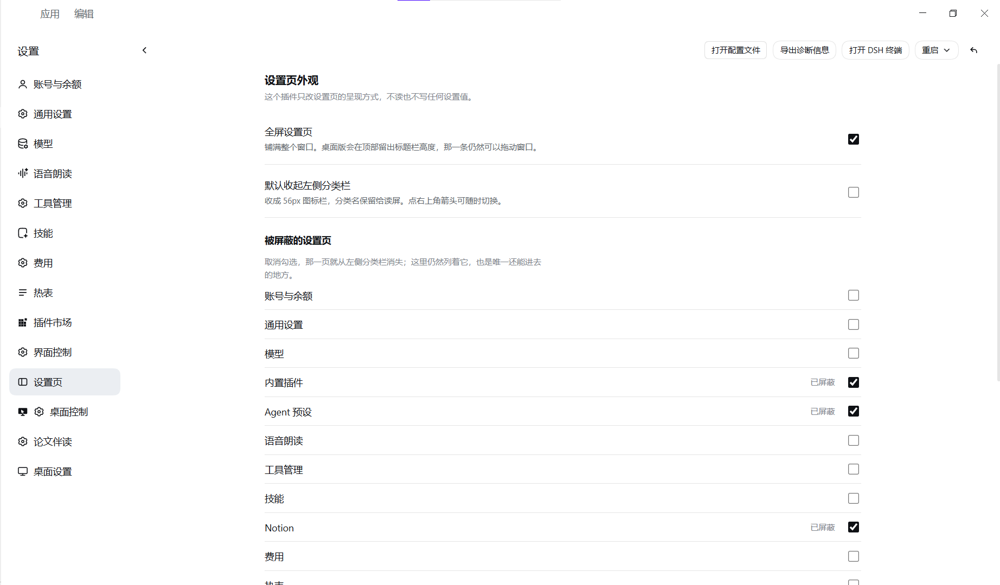
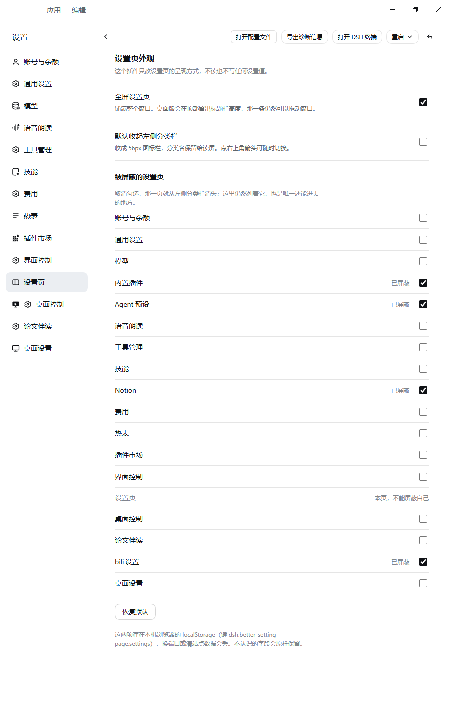
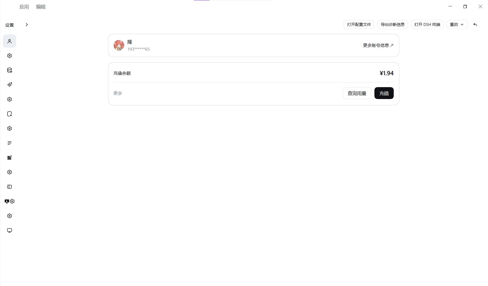

# Better Setting Page · 全屏设置页

[English](README.md) · **中文**

> **你的设置面板现在是个 800px 的弹窗。把窗口还给它。**
> 点一下，弹窗变成铺满窗口的页面；不想看左侧分类栏的时候，它收成一条 56px
> 的图标列 —— 竖屏时也一样，那里分类名和正文本来正在抢同一个 800px。

## 为什么值得装

每装一个带设置页的插件，左侧分类栏就多一行，于是那个弹窗越滚越长、越来越想要宽度：
一页「每类一张卡」的设置放在 800px 里根本读不下去，而弹窗四周剩下的屏幕是你的，不是它的。
这个插件**不增加任何设置项**，只把设置页本该有的地方还给它，并在你想省地方时把 132px
还给内容区。

## 截图



*可以藏起一部分设置页*：内置插件、Agent 预设、Notion、bili 在这里取消勾选，它们就从左侧分类栏消失 —— 只留本页这一个入口还能进去。



*竖屏也放得下*：分类栏与内容列不再抢同一个 800px，又高又窄的窗口照样读得下去。



*分类栏可以收成图标栏*：56px 宽，分类名留给读屏；点标题栏上的箭头随时展开。

## 安装

```powershell
dsh plugin --profile <profile> add dsh-better-setting-page
# 然后重启那个 profile 的窗口 —— 浏览器缓存着旧的 bundle
dsh --profile <profile>
```

`Requires DSH ≥ 0.2.x` —— 确切下限待确认。对照版本是宿主 `0.2.2-rc.1`
（解包 asar 里的 `@deepseek-ai/dsh-client-ui-settings-general` 0.2.2-rc.1）；
如果后来的版本把这些锚点挪了，表现只是这些开关不再生效，
[「写给做同类补丁的人」](#写给做同类补丁的人) 那节写了该去看什么。

### 为什么必须重启

客户端 bundle 每个窗口只加载一次，这里没有任何热替换。

## 你会得到什么

| | |
|---|---|
| 铺满窗口 | 面板占满整个窗口，圆角与投影去掉。桌面版把标题栏高度留成上边距，那一条仍然能拖动窗口。 |
| 可收起的分类栏 | 页头**最左**多一个箭头，一点就把分类栏收成 56px 宽的图标列。分类名留在无障碍树里，读屏和 `Tab` 仍然念得出来。 |
| 记在这个浏览器里 | 三个开关存在本机浏览器 profile 的 `localStorage`，键 `dsh.better-setting-page.settings`。 |
| 自己的一页设置 | **设置 → 设置页** 里有这三个开关、一份**屏蔽列表**和**恢复默认**。没有这一页，讨厌全屏的用户除了卸载插件没别的办法。 |

全屏**默认开**，分类栏**默认展开**，开关动效也**默认开**。三个都能切，**切完立刻生效**
（不用刷新、不用重启），重启之后仍然记得。

页头按设置页该有的样子摆：**左上是展开/收起，右上才是退出**；右上那个关闭键现在画的是
**拐弯的返回箭头**，不再是叉号。

### 关闭方式和以前完全一样

它仍然是宿主自己的按钮 —— 同一个节点、同一个点击处理、同一个无障碍名字 —— 所以怎么关
没变，只是长什么样变了。`Esc`、关闭按钮、点遮罩都还能用。遮罩还在、还能点，只是全屏时
它被面板盖住了，实际上你会用 `Esc` 或关闭按钮。

## 收起分类栏到底换来了什么

省下 132px 听着像是收纳活，其实不是。设置页的宽度就那么多，分类栏是它跟自己抢地方
的那一处 —— 而收起这一下，横着拿窗口和竖着拿窗口都受益。

- **横屏、左右分栏**：分类栏从 188px 压成 56px 的图标栏，这 132px 直接还给内容区。长
  说明不再在奇怪的位置折行，一行一行的设置项不再挤成两行，原来被迫变成一大段的文案又
  回到一行里。
- **竖屏、窄窗（半屏、小笔记本）**：这时候分类栏不只是「空着没用」，它是在抢 —— 同一个
  800px 里，分类名和正文都想要可读，最后输的总是你真正要读的那部分。收起来以后分类名
  让位，正文不再需要横向滚动，也不用把每句话都折成一堵墙。

所以这个开关不是为了「少一点边框」。它要的是同一页在两种朝向下都读得下去：竖屏模式和
横屏模式下，版面都比分类栏大敞着的时候更从容、也更好看。

分类栏收起是纯 CSS：分类名只是视觉隐藏，没有从文档里删，所以 `Tab` 仍然逐个聚焦、读屏
仍然念得出来。没有「悬停临时展开」：只有那个箭头会切换状态，别的都不动。

## 设置页开关动画

设置页打开时有一段短动效：面板先落地，标题、分类栏、页头和内容行在之后半秒里依次浮起，
总共 458ms —— 这个数字是量出来的，不是猜的。800px 窗口档不逐行错峰，改成 260ms 整体上浮：
小弹窗一行一行地动，看起来像坏了。

这段入场现在也覆盖**每一个插件**的设置分区，包括宿主自己那几页。别人的内容只给一层、
一个 90ms 的拍子：逐行错峰等于去猜我们没有的 DOM，猜错就完全不动。我们自己那页保留
90 / 126 / 162 / 198ms 四步，并且被排除在通用规则之外，所以同一行不会动两遍。

关闭更快也更简单：全屏 150ms、窗口 160ms，边淡出边往上走一点。宿主是同步卸载整块面板的，
所以关闭动画演在「刚刚离开文档树」的那个节点上，演完再丢 —— 页面不会闪回来。

不想要就在自己那页关掉**设置页开关动画**。系统开了「减少动效」时是直接跳过，不是变快；
这种情况下开关下面会多一行小字说明，免得「开着却没动」看起来像坏了。

## 我能配什么

四个字段，全在它自己那一页：

| 字段 | 默认 | 含义 |
|---|---|---|
| `fullscreen` | `true` | 铺满窗口，而不是 800px。 |
| `navCollapsed` | `false` | 把分类栏收成图标列。 |
| `motion` | `true` | 设置页打开、关闭时播放动画。 |
| `hidden` | `[]` | 从分类栏里移走的页面 id，见[屏蔽设置页](#屏蔽设置页)。 |

存储形状：

```json
{ "version": 1, "fullscreen": true, "navCollapsed": false, "motion": true, "hidden": [], "unknown": {} }
```

这个版本不认识的键会放进 `unknown` 原样写回，降级或更高版本都不会丢数据。记录坏掉
时回落默认值，不抛错。

## 屏蔽设置页

每装一个带设置页的插件，左边的分类栏就多一行；有些行你一辈子都不会点。这一页可以把
它们从分类栏里移走，不用卸载任何东西 —— 而且移走之后，仍然从这一页进得去。

列表是从槽位注册表读的（`ctx.slots.entries("settings.section")`），不是从 DOM 抓的。
冷启动时分类栏还没挂载，靠 DOM 抓会拿到空列表，然后把你的选择覆盖成空。

- **所有页面都列出来，包括已经屏蔽的。** 已屏蔽的那一行在这一页里仍然能点、点了正常
  进入。屏蔽之后只能从「屏蔽它的那一页」才进得去，那还是进得去；真正不能接受的是屏蔽
  变成单向门。
- **这一页不能屏蔽自己。** 它没有勾选框；就算别处硬写进去，它自己的 id 也不会留在
  `hidden` 里。
- **你正待在被屏蔽的那一页上时，那一行会回来。** 规则是
  `nav [data-bsp-hidden="1"]:not([aria-current="true"])`，所以从列表点进去之后，分类栏
  仍然告诉你「你在哪」。
- **跳转是核对过的，不是发出去就不管。** 点击先走宿主自己的 store（`openSection`），
  然后轮询 `aria-current` 约 320ms；store 那一步没落地就直接点那一行。store 只改
  `activeId`，并不保证渲染。

`hidden` 存的是页面 id：字符串、去空白、去重复、不收空串、不收这一页自己的 id，最多
64 条。

## 限制

- **这不是「窗口全屏」。** `html[data-fullscreen]` 是**窗口**的状态，不是这个插件的；
  硬写它连宿主菜单的锚定位置都会一起变。这里只让设置页填满已有的窗口。
- **拖拽带只在桌面版有，而且还没在桌面版验过。** 网页运行时没有标题栏
  （`--dsh-frame-top-clearance` 无值），于是补白算出来是 `max(0px, 0px)`：插件既不补
  上边距、也不加拖拽区 —— 也就是说，这条拖拽带存在的理由，恰好是这一版没法证明的
  东西。在真机桌面版跑过之前，那 40px 拖拽区请当作**未验证**。
- **窄窗口保持宿主布局。** 768px 以下宿主自己就把面板变成全屏 sheet；这时候再收成
  56px 会什么都不剩，因此收起规则放在 `@media (min-width: 768px)` 里。
- **设置按 origin 隔离。** 换个端口就是另一个 profile，三个开关和屏蔽列表都会回到默认。
- **屏蔽只是改分类栏，不是卸载。** 被屏蔽的页面仍然存在、仍然注册、仍然在跑，只是那一行
  不见了。它对应的插件并没有被停用，所以别拿这个当「关掉一个你信不过的插件」。

## 写给做同类补丁的人

全部状态是这个插件挂在 `<html>` 上的两个属性：

```html
<html data-bsp-fullscreen="on" data-bsp-nav="collapsed">
```

一份样式表读它们。不在宿主的 React 树上重渲染；唯一的 `MutationObserver` 盯的是
`document.body` 上「面板被 portal 进来」这件事，它给分类栏的行打一个 data 属性，不改
宿主自己的结构。宿主的 store 只在 `openSection` 那一处被调用（那本来就是打开一页的
正规办法）。宿主随时可以挂载、卸载、再挂载设置面板：开关的状态早就在根元素上了，
行上的标记每次挂载都会重新打一遍。

### 关于宿主 DOM 的三件事

**1. `[data-slot="…"]` 是渲染器的锚点，不是容器。** 渲染器的 `SlotOutlet` 把它输出成
`style: { display: "contents" }`，所以这个元素不产生盒子：它的子元素直接参与**祖父
层**的布局。而且它挂在 `.actions` / `.options` 里面，从来不是 `.header` 的直接子级。
所以：

```css
/* 对：用后代匹配找到页头所在的那一行 */
div[data-shortcut-modal="settings"] > div:has([data-slot="settings.action"])
/* 错：会静默匹配到 .actions */
div[data-shortcut-modal="settings"] > div:has(> [data-slot="settings.action"])
```

**2. 遮罩上挂着「点外面关闭」。** `div.mask` 带 `onClick={onClose}`。给它
`display: none` 或 `pointer-events: none` 不是「顺手清干净浮层」，而是无声无息删掉
一个功能。这个插件只摘掉遮罩的**外观**（`background: transparent;
backdrop-filter: none`），盒子和命中区原样留着。

**3. 网格区域名是 CSS-Modules 的哈希。** 只覆盖 `grid-template-columns` 这个长写属性。
重写 `grid-template` 简写会连 `"title header" / "nav options"` 一起重置，布局直接塌。

样式表里没有 `!important`，也没有任何宿主类名：每条规则都锚在
`div[data-shortcut-modal="settings"]` 这个稳定的 data 属性上，特异性 (0,1,1) 本来就
高于宿主的模块类 (0,1,0)。

## 文件

```
client.js           浏览器半边：样式表、分类栏开关、设置页
index.js            host 半边：只为让 bundle 解析得到，不注入任何东西
cordis.patch.yml    bundle patch
locale/             分类名与那一页的中英文案
screenshots/        上面那几个占位等着要的图
test/settings-page.test.mjs   65 条断言，零依赖
```

## 测试

```powershell
node --check client.js
node --check index.js
node test/settings-page.test.mjs     # → PASS — 65 groups
```

测试用桩掉的 `window.__ModuleLoader__` 执行真的 `client.js`，然后对导出的字符串和
store 下断言。里面埋了四条**回归陷阱**，每条都实测过会把套件变红才复原：页头选择器被
「顺手简化」回直接子级、全屏规则不再挂在本插件自己的属性上、隐藏规则不再只圈我们自己
标记过的行、安装时不再应用已存的屏蔽列表（少了它，屏蔽要等你手动改一次设置才生效）。

页面是不是真的铺满窗口属于机器验证，不是单测能证明的事：真的 `client.js` 另外在 Chrome
里跑了一遍，对着从宿主面板抄下来的 DOM，并且**先 `apply()` 再不挂面板**（真的冷启动
顺序）。细节与实测数字在 [CHANGELOG.md](CHANGELOG.md)。

## 许可

MIT
